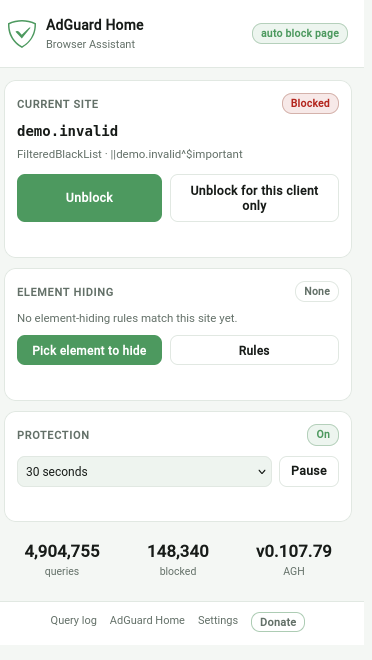
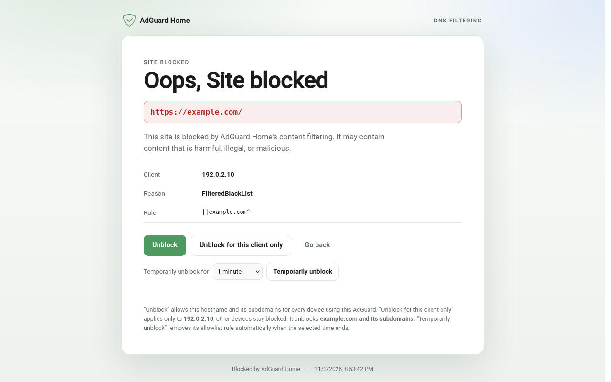
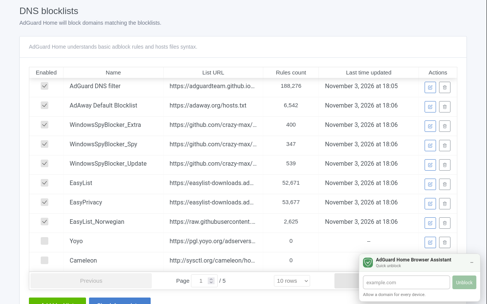

# AdGuard Home Browser Assistant

[](https://github.com/tmiland/adguard-home-browser-assistant)
[](LICENSE)
[](https://www.mozilla.org/firefox/)
[](https://extensionworkshop.com/documentation/develop/manifest-v3-migration-guide/)
[](https://github.com/sponsors/tmiland)

An unofficial Firefox companion for **AdGuard Home (AGH)**: see the filtering
state of the current tab, block or unblock the current site for everyone or just
this client, pause protection, view AGH stats, hide page elements, and get a
useful block page when an HTTPS navigation fails — using your existing logged-in
AGH session.

It does not filter traffic itself. AGH does the DNS filtering; this extension is
the browser-side control surface.

> Not affiliated with AdGuard. AdGuard Home is a separate open-source project.

**Status:** v1.1.0 · Firefox MV3 · AMO 1.0.0 pending review.

## Screenshots

| Toolbar popup | Automatic block page |
| --- | --- |
|  |  |

<p align="center">
  
  <br>
  <sub>Quick unblock widget on the AdGuard Home web interface.</sub>
</p>

## Features

### Toolbar popup

- Current tab status from AGH `check_host` — **Blocked** or **Allowed** — with
  the applied rule/reason and the client.
- **Block** or **Unblock** the current hostname for all devices:
  `||host^$important` / `@@||host^$important`.
- **Block / Unblock for this client only**:
  `||host^$client='<client>'` / `@@||host^$client='<client>'`.
  The client comes from the latest query-log entry for the host; set one in
  Settings if auto-detection is wrong.
- **Undo** a block or unblock for 60 seconds: the previous user-rule set is
  restored, including a temporary-unblock timer the action cancelled.
- **Temporary unblocks** with a live countdown and **Cancel**.
- **Protection**: on/paused, pause for 30s / 1m / 5m / 15m, resume.
- **Stats**: total queries and blocked count from `/control/stats`.
- Links to the AGH query log, AGH home, Settings, and **Donate**.

### Automatic HTTPS block page

Top-level navigation errors are caught with `webNavigation.onErrorOccurred`.
The extension confirms with AGH `check_host` (and the latest query-log entry for
CNAME/IP/cached cases), then replaces the browser error with `blocked.html`.

No CA, no TLS interception, no VIP/NAT. The block page offers:

- **Unblock** for every device;
- **Unblock for this client only**;
- **Temporarily unblock** for 30 seconds, 1 minute, 5 minutes, or 15 minutes.

It polls through AGH's asynchronous filter rebuild (~6 s on a typical home
server). Temporary rules are removed by the background after the chosen
duration; if the browser closes first, cleanup resumes on the next extension
start.

### Element hiding

AGH accepts cosmetic rules such as `example.com##.ad-banner` and stores them in
its user rules, but DNS filtering cannot inject CSS. The assistant reads those
rules back and applies the matching CSS in Firefox, so the rule is visible and
editable in AGH while the browser does the hiding.

- Toolbar **Pick element to hide** or right-click → **Hide element with AdGuard
  Home Assistant** starts a picker: hover to highlight, click the element, edit
  the generated selector if needed, then **Hide**.
- It hides only the selected element by default; tick **Hide all matching
  elements** to use a broader selector.
- Picked rules are saved to AGH user rules by default. If the AGH session is
  unavailable, the rule is saved locally instead. Rules saved to AGH appear under
  **Rules from AdGuard Home** in Settings, not in the local rules box.
- Settings lists AGH cosmetic rules with a **filter box**, **Remove** buttons,
  and **Refresh**. Removing a rule through the assistant also refreshes open
  tabs.
- Global CSS-injection rules (`example.com#$#body { ... }`) and exceptions
  (`#@#`, `#@$#`) work.
- Native CSS selectors (including `:has()`) are applied directly. A small
  extended-CSS engine supports `:remove()`, `:style()`, `:has-text()`,
  `:upward()`, `:matches-css()` and `:not(:has-text(...))`; other extended
  selectors are skipped.

AGH user rules are read through the same logged-in session; local rules are
stored with `browser.storage.local`. Scriptlet/JS rules (`#%#`, `#@%#`) are
deliberately not executed.

### Blocklist catalog

The toolbar popup and Settings link to a dedicated **Blocklists** page backed by
[`tmiland/dns-blocklist-catalog`](https://github.com/tmiland/dns-blocklist-catalog).

- **7 packs** (Starter, Balanced, Strict, Security, Family, Privacy, Smart home)
  covering **92 curated lists**, with health data where available.
- Lists already present in AGH are detected by URL and marked **Subscribed**;
  packs offer **Add missing**.
- Import uses AGH's `/control/filtering/add_url` for each missing list, then one
  `/control/filtering/refresh`.
- Search all lists, inspect topics and health, or import an individual selection.
- Health is advisory: warnings are shown, but the import is not silently skipped.
- The catalog is cached for five minutes; **Refresh catalog** forces an update and
  the page falls back to the cached copy when GitHub is unreachable.

### Query-log buttons and Quick unblock

- Blocked query-log rows get an **Unblock** button.
- A floating **Quick unblock** widget is branded **AdGuard Home Browser
  Assistant** and can be collapsed; the state is remembered.
- It accepts a URL or domain, normalizes it, adds the allowlist rule, clears
  AGH's cache, and polls `check_host` until the rebuild finishes.

### Dynamic AGH UI integration

There is no hardcoded AGH host. After you configure your AGH URL, the extension
injects its AGH UI helper only on that origin. This also means it works with a
custom hostname, reverse proxy, or port.

## Install

### Temporary install

1. Make sure your AGH UI is reachable and logged in (for example
   `https://adguard.example.com`).
2. Firefox → `about:debugging#/runtime/this-firefox` → **Load Temporary Add-on…**
3. Select `manifest.json` from this repository.
4. Open **Settings** and enter your AGH URL.
5. Open the toolbar icon. The popup shows the current site, protection,
   element-hiding state, and stats.

### AMO

The AMO listing has been submitted and is pending review. Once approved,
install it from:

`https://addons.mozilla.org/firefox/addon/adguard-home-browser-assistant/`

For a permanent self-hosted install, sign the XPI yourself or publish through
AMO:

```sh
web-ext build
web-ext sign
```

AMO-listed builds receive updates through AMO automatically. The manifest
intentionally has **no `update_url`**; that key is only for self-distributed
extensions and would override AMO's update channel.

## Setup

1. Open **Settings** and enter the AGH web UI origin, for example
   `https://adguard.example.com` or `http://192.168.1.10:3000`.
2. Log in to that AGH UI in the same Firefox profile.
3. The extension reuses the `agh_session` cookie. No password is stored.
4. Optionally set a client IP/name for “this client only” actions.

The default client detection uses the latest query-log entry for the hostname.
If that is wrong, set the client explicitly in Settings.

## How it works

```text
Firefox extension
  ├─ popup / options / block page
  ├─ background MV3 event page
  │    ├─ AGH API via existing agh_session cookie
  │    ├─ direct fetch, then same-origin AGH-tab bridge
  │    ├─ temporary unblock cleanup via browser.alarms
  │    └─ dynamic AGH UI script injection
  └─ cosmetic content script
       ├─ normal CSS rules
       ├─ extended-CSS runtime
       └─ element picker
```

- **Auth:** a direct extension-origin request is tried first. If SameSite/CORS
  prevents it, a same-origin fetch runs inside an AGH UI tab
  (`src/api-bridge.js`).
- **Block page:** `webNavigation.onErrorOccurred` checks AGH before replacing
  the error page, so ordinary network failures are not misreported as blocks.
- **Temporary unblocks:** stored in `browser.storage.local`; cleanup is driven
  by `browser.alarms` so it survives MV3 event-page suspension.
- **Undo:** the previous user-rule set is kept in `browser.storage.local` for
  60 seconds and only restored if AGH's current rules still match what the
  action wrote.
- **Element hiding:** CSS is injected at user origin with
  `scripting.insertCSS`, so page CSP cannot block it.

## Permissions and privacy

- No credentials are stored.
- No telemetry, analytics, or remote logging.
- The AGH session cookie is used only for AGH API calls.
- The public blocklist catalog is downloaded from
  `raw.githubusercontent.com/tmiland/dns-blocklist-catalog`; only the catalog is
  fetched, no user data is sent.
- Local rules, settings, pending temporary unblocks, the catalog cache, and the
  60-second undo snapshot stay in `browser.storage.local`.
- `<all_urls>` is required to detect failed navigations, apply element-hiding
  rules, and inject the AGH helper on the origin you configure.
- `tabs`, `webNavigation`, `scripting`, `alarms`, `contextMenus`, and `storage`
  support those features.

## Rule syntax

AGH uses Adblock-style rules
([syntax reference](https://adguard-dns.io/kb/general/dns-filtering-syntax/)).
The assistant uses:

- `||example.com^` — the domain and all subdomains.
- `@@||example.com^$important` — allowlist exception for all clients.
- `@@||example.com^$client='192.0.2.10'` — exception for one client.
- `||example.com^$important` — block rule for the site.
- `example.com##.ad-banner` — hide matching elements for the site and its
  subdomains.
- `example.com#@#.ad-banner` — cancel that hide rule.
- `example.com#$#body { overflow: auto !important; }` — inject a style rule.
- `example.com##.ad:has-text(/sponsor/):remove()` — extended text match.
- `example.com##.ad:upward(.feed)` — hide the matching ancestor element.
- `example.com##.ad:style(border: 1px solid red !important)` — extended style.
- `example.com##.ad:matches-css(display: none):remove()` — computed-style match.

When a site is blocked by a **parent-domain** rule (for example
`||memfault.com^` blocks `chunks.memfault.com`), the assistant unblocks the
**rule's domain** (`@@||memfault.com^$important`), not just the current
hostname, so every subdomain of that domain works.

## Development

```sh
# Unit tests
node --test test/*.test.js

# Firefox validation
web-ext lint

# Package
web-ext build
```

Main files:

- `src/background.js` — MV3 event page, AGH API, block page, unblocking,
  protection, stats, alarms, dynamic injection, catalog fetch/import.
- `src/rule-utils.js` — pure allow/block rule builder, undo planning, duration
  labels.
- `src/list-utils.js` — pure rules-list filter used by Settings and the tests.
- `src/blocklist-utils.js` — catalog validation, pack/list selection, URL
  dedupe, search, and health labels.
- `src/cosmetic-rules.js` — Adblock cosmetic parser/matcher, including extended
  selectors.
- `src/cosmetic.js` — element hiding, extended-CSS runtime, picker.
- `src/content.js` — query-log buttons and Quick unblock widget.
- `src/api-bridge.js` — same-origin AGH API bridge.
- `popup.html|css|js` — toolbar popup.
- `blocked.html|css|js` — automatic block page.
- `options.html|css|js` — settings.
- `blocklists.html|css|js` — blocklist catalog, pack/list browsing, and imports.
- `test/` — parser, rule-builder, and catalog helper tests.

## Limitations

- Firefox only. Per-browser, not network-wide; phones/TVs/IoT do not get the
  block page or element hiding.
- Automatic pages apply only to top-level navigations, not blocked
  subresources.
- The AGH session must be valid; if it expires, open AGH, log in, and retry.
- Browsers can hold a blocked `0.0.0.0` answer for up to
  `blocked_response_ttl` (10 s); if a redirect still fails, wait and reload.
- Temporary unblocks are timer/alarm-based, not AGH-native. If the browser is
  closed, cleanup runs on the next extension start; if the AGH session is
  unavailable at expiry, removal is retried.
- Element hiding applies only in Firefox with this assistant. AGH stores the
  cosmetic rules, but its DNS engine does not inject CSS.
- Cosmetic rules are read from AGH **user rules** and the local rules box; rules
  inside subscribed filter lists are not imported.
- The extended-CSS engine covers common selectors but not every AdGuard extended
  selector (for example `:matches-css-before` is skipped).
- On pages with a strict Content-Security-Policy, CSS is injected at user origin
  so page CSP does not block the rules. The picker overlay uses a separate
  shadow-root UI.

## Troubleshooting

**The popup says “Setup”**
: Open Settings and enter your AGH URL, then log in to that AGH UI.

**The AGH widget or query-log buttons are missing**
: The helper is injected only on the configured AGH origin. Reload the AGH tab
  after saving the URL.

**Unblock says the session expired**
: Log in to AGH in the same Firefox profile, then retry.

**The site still looks blocked after Unblock**
: AGH rebuilds filters asynchronously (~6 s), and clients can cache the blocked
  answer for up to 10 s. Wait, reload, or flush the client DNS cache.

**Temporary unblock did not disappear**
: It retries every 5 minutes if AGH is unreachable. Open the popup to see the
  pending entry and use **Cancel**, or check that the AGH session is valid.

## Contributing

Issues and pull requests are welcome. Please keep changes focused, run the
tests and `web-ext lint`, and describe the AGH/Firefox versions you tested.

## Support

If this extension saves you time, you can support development via
[GitHub Sponsors](https://github.com/sponsors/tmiland).

Bug reports and feature requests:
[GitHub Issues](https://github.com/tmiland/adguard-home-browser-assistant/issues).

## AI assistance

This extension was coded by **DeepSeek V4.1 Flash**, an AI coding agent running
in OpenCode, with direction, testing, and review from the maintainer. Review the
source before deploying it.

## License

MIT — see [LICENSE](LICENSE). This is an unofficial project, not affiliated with
AdGuard.
